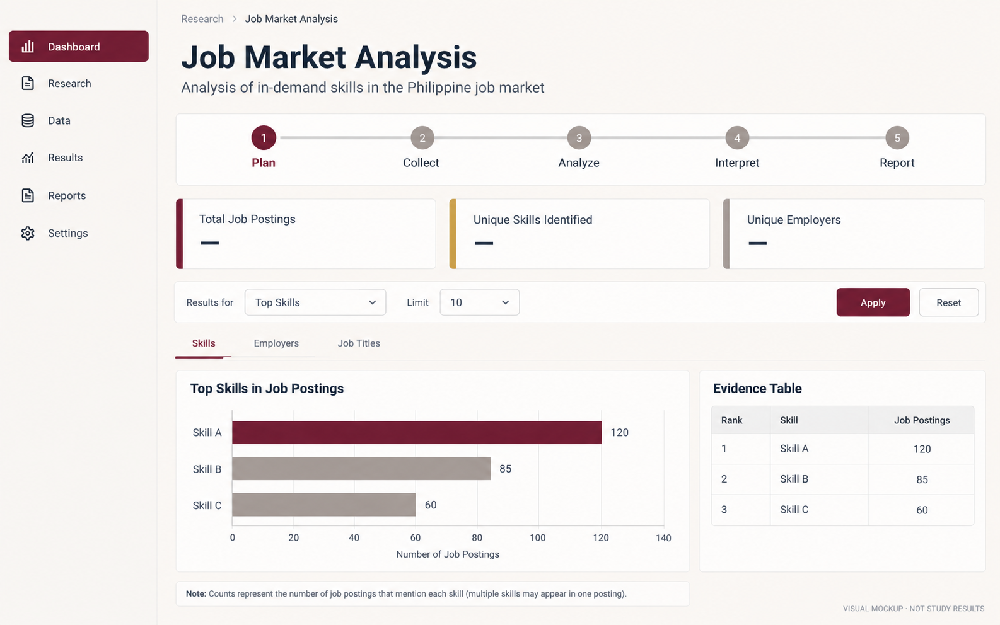

# Research workspace visual direction

**Status:** Reference presentation updated through v3.0.4. Counts and insight summaries are calculated from the active selection.
**Reference:** The user supplied four Job Market Analysis screens. Match their proportions, compact pipeline, metric cards, selected tabs, and chart-plus-insight compositions. Keep the sidebar and illustration institution-neutral; do not use MSU-IIT's name, seal, or claimed affiliation.

The latest references use five unnumbered, icon-left pipeline cards; value-first metrics without extra badges; and separately bordered result tabs. The dashboard must fill the available viewport beside the sidebar. Reference-image widths are comparison targets, never a fixed application width. The 232 px sidebar uses aligned 24 px icon slots, 22 px symbols, readable labels and at least 40 px navigation rows. Hover uses soft maroon with dark maroon text/icons; the active row stays white on deep maroon without changing geometry. The role distribution graphic counts linked reference roles, not a sum of overlapping advertisements.

## Visual reference

The image is a visual benchmark for spacing, hierarchy, chart emphasis and evidence proximity. Its displayed counts are placeholders, not findings. The application must use the selected research data for every count and export.

The shared theme uses warm ivory surfaces, maroon primary emphasis, restrained gold, readable charcoal text, aligned controls, and consistent navigation. The shared sidebar and the Job Market Analysis route follow the supplied composition across Skills, Roles and locations, Qualifications, and PSF-AAI demand.

Research-specific adaptations: retain the live dataset, controls, evidence, and export rows; use question-appropriate charts and denominators; keep long labels readable. Use a generic research identity in place of the university branding shown in the reference. All displayed findings remain data-driven; reference-image counts are illustrative only.

## Design intent

Make the research workflow feel calm, clear, and dependable. Researchers should see where they are, what the current page is for, what evidence supports a decision, and what action comes next. Visual hierarchy should clarify the work without suggesting findings that are not in the data.

This is a presentation system. It does not change research data, labels, calculations, mappings, exports, navigation routes, or authentication.

## Shared visual system

| Element | Direction |
| --- | --- |
| Brand | Deep maroon, #78182B; use for primary actions, active navigation, key chart emphasis, and page accents. |
| Supporting accent | Warm gold, #D6A33D; use sparingly for numbered workflow markers and framework emphasis. |
| Foundation | Warm ivory, #FBF8F4; white surfaces, neutral #F6F5F3, and charcoal #24303D. |
| Semantic states | Keep success green, information blue, review/warning amber, and errors red distinct from brand decoration. |
| Type | Existing sans-serif family; compact page titles, readable body text, tabular numerals for counts, sentence case labels. |
| Spacing | 4, 8, 12, 16, 24, and 32 px rhythm. Use 16 px card padding and aligned control rows. |
| Controls | 44 px minimum height, consistent 8 px corners, visible keyboard focus, clear disabled and busy states. |
| Surfaces | One visible card layer for a section, 10 px shared radius, fine neutral borders, and restrained shadows. Avoid nested bordered boxes. |
| Layout | Full-width Job Market Analysis canvas, responsive cards and tables, compact breadcrumb, generic branded sidebar, grouped navigation. |
| Icons | Material Symbols. Use a stable icon and semantic color for the same action/status on every page. |

## Page direction

| Route | Visual hierarchy |
| --- | --- |
| Sign in | One centered form with clear identity, access-help text, and concise verification state. |
| Overview | Actual study counts, current workflow state, one next action, then supporting steps. No decorative data-like sparklines. |
| Upload study data | File selection and encoding first, compact preview next, then save. Keep source data visibly distinct from analysis transformations. |
| Review data quality | Screening scope, exclusions and duplicate checks first; preview and evidence remain easy to inspect. |
| Extract skill phrases | Current-input state, extraction action/progress, and saved result status. Keep candidate phrases separate from reviewed labels. |
| Review and label phrases | Review table first, save actions close to it, and source evidence available beside each decision. Preserve the compact table workflow. |
| Train classifier | Reviewed-label eligibility and source selection first, model action next, then recorded run status. Predictions never look like approved labels. |
| Evaluate models | Evaluation design, held-out data definition, and computed metrics in that order. Show a metric only when it was actually calculated. |
| Job market | Hero, five compact workflow stages, four selected-data metrics, aligned controls and export, four result views, chart-specific insight summaries, readable labels, and complete evidence tables. |
| PSF mapping | Competency decision, framework evidence, Range of Application, and save status presented together without nested cards. |
| Employer–PSF alignment | Alignment categories and denominators first, then evidence-backed charts and table. Gold is a visual accent, not an alignment claim. |
| Unmapped / emerging skills | Distinguish “not clearly mapped” from “framework gap.” Keep review candidates separate from confirmed researcher decisions. |
| Reports | State export scope and available files; keep download actions easy to find and preserve complete records. |
| Research readiness | Audit checklist with clear pass, warning, and blocked states. A pass never implies thesis approval. |
| Methodology | Structured reading flow: data, definitions, decisions, and limitations. Keep citations and research wording intact. |
| Feedback | Short input form with privacy/purpose context and clear submit/confirmation state. |
| Settings | Group controls by data, review, analysis and model behavior; label the effect before the control. |

## Chart and evidence rules

- Use maroon for the main series and gold for a deliberate comparison or highlight; use neutral colors for secondary bars. Use the shared categorical palette only when several series need distinction.
- Keep semantic status colors stable across icons, badges, tables, and charts.
- Keep integer advertisement axes on whole numbers. Use readable horizontal bars for long labels and heatmaps only for real comparisons with explicit denominators. Put long skill or competency labels on heatmap rows and comparison groups in columns; use bars for discrete sample-frequency bins.
- Hover adds exact values and source context; it must not be the only way to discover an essential count.
- Do not truncate source labels in evidence tables or exports. Explain overlapping categories and multi-mapping in nearby text.
- Loading skeletons appear only while the page or data is genuinely unavailable; keep existing content visible during background work.
- The analysis overview uses a heading followed by five equal, unnumbered cards with an icon at left, matching the supplied reference. Four compact KPI cards put values above captions, with no added badges. Each result view uses separately bordered tabs and compact chart-and-insight panels.

## Acceptance checks for future interface work

1. The same maroon/gold, neutral surfaces, type scale, spacing, icon meaning, and status colors appear on every route, including sign-in. The shared sidebar brand remains institution-neutral.
2. Desktop, tablet, and mobile layouts wrap without clipping titles, controls, charts, tables, or account actions.
3. Every control is keyboard reachable and has a visible focus state; status does not rely on color alone.
4. Each section has one clear visual container layer, aligned controls, and a useful empty, loading, error, and success state.
5. Charts show only observed data, preserve exact calculations and exports, and use appropriate labels and denominators.
6. Existing data, workflow, permission checks, model behavior, and exports still pass the project's automated checks.

## Suitability assessment

This direction fits a Philippine academic research dashboard: it favors traceability, legible evidence, conservative status language, and repeatable workflow over promotional visuals. The maroon/gold choice is an aesthetic reference only; there is no use of official seals or a claim of university affiliation. Research claims and result graphics remain driven by the selected dataset and reviewed evidence.

## PSF Mapping reference, v2.0.116

Use the supplied PSF Mapping screen for the main content: full-width campus banner, compact breadcrumb/account row, then three single-layer panels for Review competency links, Competency demand, and Occurrence-level mapping evidence. Source metadata uses a compact linked table; the source text starts collapsed. Saved state, reviewer/date, current choices, rationale, confirmation, and save action stay together. Demand controls precede a compact ranked chart and the complete paginated table. Keep the current 232 px sidebar unchanged.

Preserve occurrence-specific review scope, source/reference hashes, stale warnings, version-conflict validation, per-competency rationales, authenticated reviewer identity, complete source evidence and export denominators. The reference values are illustrative; all displayed values come from the active dataset. Semantic success and information colors remain distinct from decorative maroon.

## Employer–PSF Alignment reference, v2.0.117

Use the supplied main-content design with the full-width maroon campus header and three rate cards: labels above large navy values, maroon symbols in pale tiles on the right. Put status evidence in a separate chart panel with visible whole-number bar labels and stable aligned/partial/unmapped colors. Group both paginated evidence tables in one panel and retain the denominator explanation in an information strip below. Keep the sidebar exactly as in v2.0.115.

Rates come from the recorded analysis metadata and retain their existing denominators; do not copy or normalize the reference's illustrative percentages. Status bars count the existing phrase–competency evidence rows. Sorting, evidence, source fields and full exports keep their current scope.

## PSF Mapping refinement, v2.0.118

The latest reference explicitly includes an inset editable form and chart frame. Reproduce those two functional groupings on this page, along with descriptions aligned beneath their headings, a shorter hero, compact source metadata, and 30 px evidence rows. This supersedes the earlier flat form/chart interpretation for PSF Mapping only. Keep 44 px control targets, full-width content, real saved/unsaved state, complete source evidence, and the existing sidebar. Visual equivalence requires a rendered-browser comparison; passing software tests alone does not establish a visual match.

PSF Mapping chart palette (v2.0.119): reference maroon `#99043B` for maximum displayed advertisement counts, including ties, and warm gray `#958277` for the other bars. Highlighting applies in Framework order, Highest demand and Alphabetical order; sorting never changes the underlying counts.

## PSF Mapping selections and insights, v3.0.1

The Skill occurrence picker starts empty on PSF Mapping; source details and the save form appear only after a researcher selects an occurrence. New/unreviewed occurrences start with no competency selected; automatic mapping candidates never prefill researcher choices. Saved researcher links are restored after selection, and unsaved-change notices compare the manual selection with that saved review. The embedded manual-labeling workflow keeps its current occurrence selection.

The demand chart and its insight panel share the exact displayed Figure rows after ordering and item-limit selection. Maroon marks every tied maximum among visible bars, even if a larger competency count is outside the current view. The panel computes leaders, next distinct count, lower counts, ties and view coverage from those rows; it does not hard-code competency names, numbers, qualitative demand tiers or field-level labor-market claims. A full-table count supplies only the displayed-versus-total coverage note. Single-item and all-tied views do not imply a comparative leader. Complete tables and exports retain the full selected evidence.

The sidebar omits Research sample, Job filters and Competency filters. Results and exports use the complete active cleaned job upload; old global filter widget values have no effect. Existing page-local chart controls remain available. Alignment Insight reads the status chart's displayed counts and calculates its shares, leading statuses and ties directly; its denominator is phrase–competency evidence groups, not unique advertisements or the separate headline rate denominators. Empty and single-status views make no comparative claim.

## Shared workspace and loading behavior, v3.0.1

All workspace page headers, including Overview and preparation/study tools, share the reference hero typography, maroon palette and responsive full-width shell beside the 232 px sidebar. Presentation CSS loads immediately after page configuration, before authentication checks and analytical imports; navigation retains its geometry during reruns. Login keeps its separate form. Existing content is not dimmed while new content loads.

Data-only reads create no placeholder boxes. First-render placeholders occupy reserved overview-summary, review-queue and research-results regions; their actual content renders in those same containers. Same-page interactions preserve existing UI without another skeleton. Failed loads do not mark a page successfully rendered, so retries can still show the missing content region. Explicit processing actions retain inline text/progress indicators.

Every bar-chart insight uses the visible figure rows after order and item limits, including location skills and reference-role distribution. Heatmap, education and posting-month summaries identify ties rather than choosing a sole winner. These are deterministic descriptive summaries of the graph data, not generative assertions; no reference-image counts or findings are embedded in them.

## Report deliverables, pipeline alignment and structured loading, v3.0.2

The Reports and downloads content follows the supplied reference: a collapsed individual-table section, an icon-led deliverables heading, and five equal-height ivory cards. Maroon icon tiles, a maroon primary Excel action, restrained secondary buttons and bottom-aligned actions share the workspace spacing scale. Downloads remain deferred until clicked; the snapshot action keeps its existing full export bundle on this host. The generated written report is labeled as a draft for researcher review.

The analysis pipeline sizes against its own content width on Methodology and Job Market Analysis. Stage icons and text align within consistently padded cards; wrapped rows remove connecting arrows to avoid disconnected marks. The chart-control information icon aligns with the first text line.

Loading wireframes match their content forms: overview metrics, review toolbar/table rows, result charts/insights, and report accordion/heading/cards. Placeholders occupy the same output slot that receives the real content and cover required freshness/source/evidence reads. They contain neutral shapes, no research values, and clear on failure. Existing materialized content stays mounted on same-page interactions. CSS-only loading animation honors reduced motion; no artificial wait, polling loop, or new data-processing pass is introduced.

Loading coverage extends to upload previews and mapping controls, quality checks, extraction references and pending results, training validation, model-evaluation eligibility and confusion matrices, feedback tables/forms, settings, readiness audits and methodology text. Components specify their actual card/field/table schema rather than selecting a generic dashboard shape. Static pipeline content renders immediately. Background activity is borderless and follows the page header; only a real running extraction or saved-results task without an existing result frame displays a pending results wireframe. Existing results remain visible on refresh. Eligibility and source reads finish before evaluation output replaces its loading slot. The wireframe renderer builds only the requested component and adds no timing delay, polling, data cache or model invocation.

## Stable PSF demand tab, sign-in chrome and Unmapped review, v3.0.3

Job Market result sections use separate keyed bodies. Changing tabs hides only inactive section bodies; same-tab updates retain the active charts. PSF controls use the available width; all-role summaries reuse the prepared analysis tables, and evidence/reference/version-keyed aggregates are prepared before chart cards render. The heatmap has a stable output key. A first-visit inline loader covers PSF summary preparation; chart counts and layout are not guessed before the data is available. A scoped completion marker prevents the new chart group from becoming visible halfway through its first render, while existing same-tab content remains visible on reruns.

Sign-in, sign-out, unverified/expired access and authentication errors suppress sidebar chrome using a temporary removable guard. A known valid authenticated rerun does not hide or rebuild the sidebar. Early shared styling stays in place, and authorization still precedes analytical UI.

Unmapped Skills uses the Job Market typography, maroon icons, warm ivory section cards and chart/insight pairing rather than copying the supplied reference literally. Two summary counts use screened canonical labels before the item limit; the third card provides an interpretation status, not an invented validation score. Graphs respect their chosen order and item limit. Insights use the displayed figure rows and respond to changed data, ties, single-label and empty views. Recurring labels are screened after canonical distinct-ad aggregation; any mapped alias suppresses a group from unmapped charts. Raw detailed evidence remains available even when a group is omitted from graphs. Recurrence does not prove emergence or a framework gap.

## Preparation and study-tool content consistency, v3.0.3

The remaining non-result pages use shared workspace content roots. Upload source controls and training configuration have explicit ivory panels; review controls, validation tables, evaluation results, feedback and settings follow the same spacing, maroon icons, field typography and control sizes as Job Market Analysis. Methodology uses readable topic expanders and preserves the complete downloadable Markdown source. Settings uses one source schema for its real headings, slider/number/text/textarea controls and matching two-column wireframe; saved keys, limits and validation are unchanged.

Collapsed navigation uses the installed Streamlit `stExpandSidebarButton` in its own fixed 44 px header slot. The workspace breadcrumb reserves that slot, the expanded header allocates a separate 44 px collapse column, and the duplicate collapsed logo is hidden in the fixed header only. The sign-in sidebar guard also suppresses this actual expand control. Both actions retain native keyboard behavior and shared maroon icon color.

Generic representative bar-chart wireframes are not used for unknown content. Unknown source schemas and PSF preparation show a compact inline activity shape; known tables show their schema header without inventing a record count. Manual review uses its known seven columns and the actual selected-page row count. Job Market metric placeholders use the same compact icon/value arrangement as its real four cards. Data-only fast paths and previously materialized regions add no placeholder, timing delay, polling or model work. The PSF chart cache hashes only the columns used for chart aggregation rather than repeated source text; the original evidence tables remain intact.

## Native account placement and a single chart tooltip, v3.0.4

The Account trigger has a content-sized toolbar slot, a stable native popover key, a 44 px target and the shared maroon icon. The menu uses native anchoring, viewport-bounded dimensions and long-identity wrapping. The detached decorative pointer is removed; no fixed popup position is imposed. Authenticated identity, role, sign-out and sign-in protection are unchanged.

Plotly is the sole owner of each chart tooltip. The retired retained-hover implementation cloned the live hover layer while leaving the original visible, creating duplicate shares and displaced copies. Its plot listeners, MutationObserver and animation-frame cloning are removed. The small upgrade script cleans up existing copied/sticky layers and prevents a queued retired scan from rebinding. CSS immediately hides legacy copies and keeps native labels from intercepting bar-pointer events. Counts, shares, hover templates, chart traces, filtering and research exports do not change. Native tooltips follow the point currently hovered; they are not pinned copies.

## Account click access, v3.0.5

The transparent native Streamlit header and its full-width toolbar pass pointer events through their empty areas to the workspace toolbar. Native header buttons and links retain pointer access, including the collapsed-sidebar control. This override applies only while the workspace toolbar exists; sign-in and portaled popover behavior retain their native handling. No synthetic click handlers, additional requests or elevated toolbar stacking are introduced.

Charts carry the application version as their UI revision. A software upgrade changes Streamlit's chart identity and replaces chart instances that may retain obsolete hover handlers or modified SVG nodes; normal reruns within the same version keep their identity. Trace values, hover templates and plotted shares are unaffected. This migration is not a substitute for checking live tooltip placement in the affected browser.

## HTML chart hover alternative, v3.0.6

The SVG popup still displayed detached text in the affected browser after the native-tooltip reset. Its display is replaced by one viewport-positioned HTML tooltip, using Plotly's already formatted hover lines from the specific chart that emitted the event. Native SVG hover remains available until a replacement has usable text and pointer coordinates; successful replacement makes the SVG hover layer transparent so a second share label cannot appear over the first bar. Original figures, templates, denominators, counts, chart styles, insights and exports are unchanged. Account's confirmed working behavior is unchanged.

The tooltip is plain text, uses the shared maroon color, ignores pointer events and stays inside the viewport. It updates rather than accumulating popups, and closes on unhover, chart exit, scrolling, resizing or Escape. No SVG cloning, synthetic hover, animation-frame loop, server request or Streamlit rerun is added. Pointer moves update position without measuring layout; content changes measure once. One observer discovers newly mounted chart roots, ignores SVG hover mutations, and removes handlers for detached charts. Repeated app reruns do not add another controller. This uses [Plotly hover events](https://plotly.com/javascript/hover-events/); formatted label extraction is verified against the installed Plotly SVG structure and covered by controller tests.

The Reports and downloads deliverables heading uses one semantic header with separate grid rows for its title and description. The maroon icon spans those rows in its own column; natural line heights and wrapping replace the competing native heading/caption wrapper geometry. Download actions and generated file contents are unchanged.

## Reference-led study content, v3.0.7

The eight study content areas share Job Market Analysis's warm surfaces, restrained borders, maroon Material icons, 44 px native controls, responsive summary cards and maroon section bars. Shared content helpers provide semantic headings, metrics and explanatory notes. Each section owns one card border. Header, sidebar, Account and authentication styling are unchanged.

- Overview uses icon-led workflow cards, a maroon next-action banner, gold primary action and a warm readiness strip. Counts, step states and next action still come from the saved workspace and readiness audit.
- Data Quality pairs the quality table with a summary computed from that same cleaned preview. Blank core-field cells are distinguished from records; ads missing both dedicated skill fields are counted explicitly without assuming their descriptions lack skills. Screening, duplicate selection, lowercase preview, source evidence and the save confirmation are retained.
- Extraction balances the two references: a compact initial state with actual reference/classifier/results-view status; loaded results have peer setup/run cards, approved/unreviewed/predicted counts and a paginated evidence section. Page entry does not download bulk extraction data. Existing processing and cancellation remain intact.
- Manual Review has actual phrase, occurrence, saved-row and reviewer cards, followed by separate setup and results sections. The real editable table, source evidence, per-occurrence PSF rationale, conflict detection, draft generation and explicit saves retain their keys and behavior. Categories and PSF fields remain researcher decisions.
- Training uses a split configuration panel, validation metrics and a distribution/insight section. The insight reads the plotted category counts and identifies categories below the existing five-example software minimum. It does not interpret those minimums as sufficient research validity. Saved models retain selection highlighting in the shared palette.
- Evaluation renders computed holdout metrics only after the existing independent-source eligibility checks. The comparison insight uses the same melted scores as the graph and identifies legacy selection procedures accurately. Empty state offers review/training actions without invented models or scores. Detailed matrices, per-class evidence, cross-validation, predictions and downloads remain available.
- Feedback uses an actual-record/correction summary, a correction panel with paired original/current and corrected fields, a history section, and a split respondent/ratings form. Corrections remain separate from original predictions; usability scale values come from saved settings.
- Settings has peer workspace/cleanup cards, four vertically aligned matching sliders with a model-directory aside, a full-width stopword field with three extraction controls, and a scale-range section. Bounds, validation, administrator permissions, archive confirmation and saved keys are unchanged.

Loading remains confined to pending data regions. Settings wireframes follow its three sections and actual control schema; quality uses its report/insight structure; feedback reserves its real four-card summary slot. These representations contain no observation values, and introduce no extra processing, model calls, polling or artificial wait. Layouts wrap to one column at narrow widths. Reference-image counts, identities, scores, extra classifiers and unsupported evaluation actions are not copied.

## Minimal content headings and collapsible evidence, v3.0.8

This supersedes the filled section bars from v3.0.7. All shared content panels use transparent heading backgrounds, dark labels and aligned maroon Material icons, following Job Market Analysis. The existing application header, sidebar and Account control remain unchanged.

PSF Mapping review/demand headings use one two-column grid: the icon centers on the title and descriptions share the title's left edge. Training and evaluation insights center vertically beside their charts; text stays left-aligned. Training and Unmapped Skills no longer repeat chart titles.

Detailed unmapped, recurring-phrase, occurrence-mapping and alignment evidence starts collapsed and renders its paginated table only when opened. Active editing/review tables remain visible. Data Quality uses a full-width computed insight followed by collapsible quality checks, removing the tall table/short insight column imbalance. Original-source and duplicate evidence are also collapsible. Cleaning, saved annotations, validation gates, counts and exports are preserved.

Verification: full suite 552 passed before the final Data Quality layout refinement; 184 focused UI/design/reference/result checks passed after that refinement, then six final dynamic-insight/evidence checks passed. Compilation, diff checks and localhost health passed. An isolated synthetic browser preview measured icon/title centers and training chart/insight centers within 0.01 px, matching description/title left edges and a transparent content-heading background. Browser control became disabled before final visual checks; no complete authenticated-page pixel verification is claimed.

## Research Readiness content, v3.0.13

Use the supplied readiness reference for content grouping while retaining the minimalist Job Market Analysis heading rule: dark text with maroon icons, transparent section headers and a single visible card layer. Keep the existing hero, sidebar and Account control unchanged. Four audit metrics lead into a compact active-study summary; source provenance uses a full-width table; reviewer IDs and usable categories use peer cards that wrap on narrow screens. Findings use escaped titles/details from the existing audit, not preset example values. Diagnostic JSON and historical disagreement evidence render only when expanded. Recommendations remain methodological guidance; the page does not certify readiness automatically. Blank source IDs are excluded from the displayed distinct-ad source count.

## Content-shaped loading states, v3.0.14

Use a lightweight shimmer confined to the content region awaiting data. Existing visible content, the header, sidebar, Account and sign-in verification remain unchanged during normal reruns. The loader adds no sleeps, polling, network reads, DOM observers or dependency.

The skeleton vocabulary follows actual UI structures: icon-left metric tiles; Overview's four cards, next-action strip and six workflow cards; structured review tables with the visible page's row/column schema; native-control-sized selectors, text areas and slider tracks; page-specific Market, Mapping, Alignment and Unmapped panels; the selected Job Market section and selected mapping occurrence; PSF demand/role chart panels and role-by-competency matrix; five report deliverable cards; Settings from SETTINGS_SECTIONS; Feedback's split usability form; Readiness's audit and study summaries; Methodology text. Empty/unknown data receives neutral shapes rather than example research observations. Placeholder table rows reserve space and do not report a dataset count.

One transform-only CSS shimmer runs per loading region, with reduced-motion disabling animation. Geometry is capped at 8 cards, 10 preview rows (12 matrix rows), 12 columns and 15 chart rows. Report figures/counts, source evidence, reviewed labels, model validation and exports are unchanged. The original ready-region/error cleanup logic is retained and tests verify no new wireframe on a normal visible-page rerun. Overview's related content now renders into the same reserved slot, preventing a full Overview silhouette from collapsing to four cards before the remaining sections arrive.

Verification: 193 focused checks passed, then the final full suite passed 555 tests in 120.31 seconds with one existing pandas FutureWarning at src/review_queue.py:138. New checks cover page structures, selected Mapping/Market variants, capped markup, no nested live regions, and form/control shapes. Existing load-phase, original-upload, cache, save, authentication, dynamic-insight, error and rerun tests passed. Two obsolete assertions were updated for the PSF chart layout and earlier lazy quality-check behavior. Compilation, JS syntax, diff and localhost health checks passed. A 1,000-iteration local Python microbenchmark measured approximately 0.0057–0.0113 ms per tested layout and 2.9–9.3 KB of markup; this measures generation overhead, not browser frame rate or school-network speed. Browser visual/animation inspection remained unavailable because browser control reported disabled.

## Workspace recovery and Readiness spacing, v3.0.15

Workspace unavailable follows the supplied reference: centered local offline-laptop illustration, maroon heading, escaped actual failure text, a tinted reason strip and native Retry/Return to sign in actions. Pink/maroon/gold SVG waves are scoped to this error state. The 1,420-byte illustration and background need no external service or dependency. Access/setup errors receive appropriate guidance rather than being described as internet failures. The sidebar stays protected; expired sessions still go to sign-in.

Research Readiness cards own their padding (1.2 × 1.35 rem desktop, 1 rem mobile) rather than relying on one Streamlit child wrapper type. Headings, captions, tables, findings and recommendations share a consistent inset. The active study dataset follows the additional compact reference: title/icon on the left, four live metrics separated by dividers, and a green Yes or warm No scope-review badge. It wraps on narrow screens; posting-date context stays below the strip. The corresponding loading silhouette follows this single-row structure. Header/sidebar, audit logic and research evidence remain unchanged.

Verification: final 242 auth, shared-workspace, design, Readiness/reference and UI checks passed in 62.15 seconds. Tests cover escaped errors, 403/404/503 guidance, retry/cache reset, sign-out, sidebar guards, live counts/scope changes and empty/populated pages. Python compilation, SVG validation, diff checks and localhost health passed. Browser control reported disabled, so final rendered spacing/reference matching remains unverified. No research rows or credentials were modified.

## Job Market section transitions and icon spacing, v3.0.16

Job Market results use a native Streamlit fragment so section/filter interactions reuse the current analysis snapshot instead of reentering the parent workspace-loading path. Job profile summaries are prepared only for Roles and locations or Qualifications; geography summaries only for Roles and locations. A full page refresh retains the existing workspace freshness workflow. No polling, parallel rendering, artificial delay or new dependency is added.

Switching sections resets only that section's loading readiness, including when revisiting a section. Its silhouette follows the selected content: skill charts, role/geography panels, qualifications, or PSF demand/role panels. The pending slot remains visible until the replacement finishes rendering; incomplete output stays hidden without losing its available width. Ordinary reruns of an already visible section retain its ready state. PSF chart loading uses the same deferred replacement. Fragment-local errors keep the existing actionable error presentation and reset loading state for retry.

Job Market heading icons have a nonshrinking 28 px wrapper with visible overflow, replacing Streamlit's narrower clipped wrapper. Content cards have 1 × 1.15 rem padding, and insight icons use nonshrinking slots. Existing heading colors, navigation, research calculations, reviewed annotations and exports remain unchanged.

Verification: full suite 563 passed in 116.85 seconds, with the existing pandas FutureWarning at src/review_queue.py:138. Regression checks cover section transitions/revisits, loading before profile preparation, no repeated skeleton on ordinary reruns, native fragment refresh without parent reads, and deferred-loader success/failure cleanup. Python compilation, diff checks and localhost health passed. Live browser animation and final pixel spacing remain unverified because browser control was unavailable.

## Responsive workspace, v3.0.17

Keep the maroon/ivory design at phone, tablet, laptop and desktop widths. Layout decisions use the main region's actual inline size, so opening the sidebar or increasing browser zoom triggers the same reflow. The target is usable content at 320 CSS px, following [W3C reflow guidance](https://www.w3.org/WAI/WCAG22/Understanding/reflow); this is a design target, not a completed conformance audit. Action buttons, text/number inputs and navigation links use at least 44 px height; number steppers are 44 px wide. This follows [W3C's minimum target guidance](https://www.w3.org/WAI/WCAG22/Understanding/target-size-minimum). Focus outlines and reduced-motion behavior remain.

At 1100 px usable width, chart/insight pairs stack and the four Overview/Market metrics become two columns. At 760 px, native form columns, Settings fields and chart controls reflow; result tabs form a two-by-two grid. At 480 px, metrics and review controls use one column. Reports and its skeleton share five/three/two/one-column layouts at usable widths of 1250/850/540 px. Native tables/editors retain their own horizontal scrolling; page-level overflow is not hidden. Long headings, labels, buttons, identifiers and metric values wrap. Heading icons reserve their own width. Mobile controls use 16 px input text; the mobile toolbar clears the native top controls and sidebar toggle. Login panels clamp to their parent width.

Charts keep their source values, counts, percentages and hover evidence. Ranked labels wrap at 24 characters with height reserved for each line; results use 12 px graph text. Dense heatmaps receive a local scroll viewport with a minimum width derived from column count; every cell and its tooltip stays present. The scroll hint is confined to narrow chart regions. Full-screen review disables outer layout containment so its fixed workspace still occupies the viewport. No screen-size JavaScript, resize polling, backend request or runtime dependency is introduced.

Verification: full suite 566 passed in 120.12 seconds with the existing pandas FutureWarning. After the final report/Overview skeleton breakpoint refinement, all 118 design/reference/performance checks passed in 19.09 seconds. Added checks preserve long-label trace evidence and escaping, dense-matrix cells/hover/identity, shared-style ordering and full-screen containment. All combined styles parsed successfully with Lightning CSS CLI 1.0.0-alpha.72; this was a validation tool only, not a project dependency. Compilation, diff and localhost health checks passed. Final desktop/mobile pixels, touch behavior and zoom reflow remain unverified because browser control reports disabled; no full WCAG certification is claimed.

## Recovery heading alignment, v3.0.18

Workspace unavailable explicitly centers both the native heading wrapper and its full-width h1 beneath the illustration. This prevents native heading alignment from pulling only the title to the left while the message/actions stay centered. Eight recovery/login/membership checks passed; compilation, diff and localhost health passed. Final browser pixels remain unverified.

## Reuse visited Job Market sections, v3.0.19

Supersedes v3.0.16's unconditional section-switch loading reset. Each of the four results sections is marked ready only after successful rendering, for the current analysis revision. Revisiting a ready section skips its loading silhouette; first visits and newly loaded analysis revisions still show the appropriate loader. Errors remove the affected section from the ready set so retry remains possible.

The existing bundle revision is passed into the Market fragment, avoiding repeated source-frame hashing during normal section interactions. Job-profile, geography and fallback skill summaries use bounded session caches with one revision each. Hidden-section title, region, city, role and heatmap selections survive native widget cleanup. New inputs, corrections, extraction records or reviewed mappings change the existing bundle revision and invalidate section readiness and derived summaries. Normal page refresh retains the existing workspace freshness checks. No polling, network request or research-data change was added. Streamlit still renders selected widgets/charts; this does not retain all sections as browser DOM.

Verification: four focused first-visit/revisit, filter-preservation, changed-input, native-fragment and retry checks passed. The initial full suite found a redundant original_text hash in standalone rendering (566 passed, one failed); the fallback now excludes that repeated evidence without modifying it. All 141 result-view, UI-performance and shared-workspace checks then passed in 38.42 seconds, including the failing regression. Compilation, diff and localhost health passed. Browser transition timing remains unverified.

## Shared phrase eligibility across results, v3.0.20

The earlier screen admitted a fragment whenever it contained a word outside a short vague-word list. The new deterministic rule requires recognized skill/tool wording, a capability expression or a concrete technical task after missing-value, connector, generic-object, incomplete-clause, benefit and promotional checks. Examples such as "long and successful," "tool and service," "accept usage," "access to clean," "activity," bare "ad hoc" and "adjacent enterprise system" are withheld. Ambiguous outcome wording is retained for review, not assigned an IRRELEVANT training label. Complete controls include ad hoc analysis, user acceptance testing, solution design, active listening and named tools; bounded knowledge/proficiency wrappers reuse known aliases.

Supersedes the earlier graph-only exclusion policy. The same eligibility rule now screens employer phrases before analytical mapping, alignment, gap summaries and PSF competency/role/family demand. Official framework labels are preserved. All skill charts use the screened occurrence table and retain distinct-ad denominators, aliases and recurrence rules. The source-linked chart_phrase_review table gives withholding reasons; all_candidates retains extraction evidence and researcher fields. Saved source records, labels, model-training data and competency-link decisions are not rewritten. Current derived mapping counts can change. Unfamiliar names may be withheld and still require source review; the rule does not certify semantic or research validity.

Analysis metadata policy is version 11 and the application-version cache key invalidates old views. Current saved extraction can be reused unless its inputs are stale. Screening evaluates unique phrases and adds no model inference or network request to chart interactions. A read-only audit of the current local extraction found none of the reported example fragments eligible and verified the file was unchanged. A synthetic 98,681-row screen/group check took 0.484 seconds on this PC; this is a local timing observation, not a production-speed guarantee or a research result.

Verification: the initial full suite found the old synthetic scale fixture incorrectly treating generic tool identifiers as skills (657 passed, one failed). The fixture now covers complete capability wording and withholding 93,622 generic identifier rows. The full suite then passed 658 tests in 127.49 seconds, with the existing pandas FutureWarning in review_queue.py. After the final wrapped-tool alias refinement, all 120 phrase/export/scale checks passed in 10.43 seconds. These tests include original-evidence immutability, denominator preservation, filtering before PSF aggregation, selected-data scope and Excel audit exports. Compilation, diff checks and localhost health passed. No browser-rendered visual verification is claimed. Changes remain local/uncommitted/unpushed.
